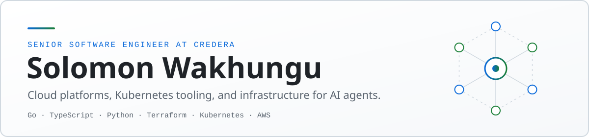

<picture>
  <source media="(prefers-color-scheme: dark)" srcset="assets/banner-dark.svg">
  
</picture>

<p>
  <a href="https://solomonwakhungu.vercel.app/"></a>
  <a href="https://www.linkedin.com/in/solomon-wakhungu-2712791bb/"></a>
  <a href="https://github.com/1solomonwakhungu/homebrew-tap"></a>
  <a href="https://hub.xerj.org/contributors/1solomonwakhungu"></a>
</p>

I'm a Senior Software Engineer at Credera building cloud platforms, Kubernetes operations, and CI/CD automation for enterprise teams. Outside of client work I build local-first open-source tooling in Go, TypeScript, and Python—focused on Kubernetes observability and practical infrastructure for AI agents—and send fixes upstream to the tools I depend on.

## Merged upstream

| Project | What I changed |
|---|---|
| [hashicorp/terraform-provider-aws](https://github.com/hashicorp/terraform-provider-aws/pull/48962) | Fixed a perpetual in-place diff on ActiveMQ brokers where `shared_resources` stayed unset after refresh. Closed two issues. |
| [helm/helm](https://github.com/helm/helm/pull/32339) | Made `get-helm-3` and `get-helm-4` bypass stale CDN responses so machines running the installer after a release get the same Helm version. |
| [VictoriaMetrics/VictoriaMetrics](https://github.com/VictoriaMetrics/VictoriaMetrics/pull/11258) | Added `.Interval` to `vmalert` templates so alert annotations and dashboard links can reference the group's evaluation interval directly. |
| [mvschwarz/openrig](https://github.com/mvschwarz/openrig/pulls?q=is%3Apr+author%3A1solomonwakhungu+is%3Amerged) | Four merged daemon fixes: retries after transient provider failures, factual startup-exit errors, retained queue-wake diagnostics, and opt-in end-to-end tests. |
| [Aviatrix Terraform modules & lab docs](https://github.com/search?q=author%3A1solomonwakhungu+is%3Apr+is%3Amerged+org%3Aterraform-aviatrix-modules+org%3AAviatrixSystems&type=pullrequests) | Nine merged PRs across `terraform-aviatrix-gcp-edge-demo` and `avxlabs-docs`, including an Edge ZTP ISO fix and CI checks for the course content pipeline. |

## Infrastructure for AI agents

**[action-hub](https://github.com/1solomonwakhungu/action-hub)** &nbsp;[](https://github.com/1solomonwakhungu/action-hub/releases)<br>
Indexed, on-demand meta-MCP layer that replaces eager tool-schema bloat with a single cache-stable search/load/execute tool (~600 baseline tokens vs. millions for large fleets). Load-tested at 44 MCP servers, 10,000 tools, and 5,000 skills. [Explainer](https://1solomonwakhungu.github.io/action-hub/)

**[contexto](https://github.com/VentureForgre/contexto)** &nbsp;[](https://github.com/VentureForgre/contexto/releases)<br>
Zero-dependency local proxy that keeps Claude Code and Codex requests under a fixed token bound by paging older turns to disk verbatim and exposing MCP search tools to recall them—with reproducible recall and cost benchmarks.

**[googlemcp](https://github.com/1solomonwakhungu/googlemcp)**<br>
Local stdio MCP server for your own Google account covering 19 Google APIs (Gmail, Calendar, Drive, Tasks, YouTube, Analytics, Search Console, Photos, and more). Read-only by default, with per-product write opt-ins, a second opt-in for destructive tools, and Terraform for API enablement.

**[runpod-vllm-deployer](https://github.com/1solomonwakhungu/runpod-vllm-deployer)** &nbsp;[](https://skills.sh/1solomonwakhungu/runpod-vllm-deployer)<br>
Python CLI for deploying OpenAI-compatible vLLM servers to RunPod GPUs (A40–B200). Plans offline, requires confirmation before billable creation or teardown, verifies readiness, and runs deterministic smoke tests.

## Kubernetes & cloud platform

**[kfleet](https://github.com/1solomonwakhungu/kfleet)** &nbsp;[](https://github.com/1solomonwakhungu/kfleet/releases)<br>
Read-only control plane for a fleet of Kubernetes clusters: a 14 MB Go hub with an embedded Primer React UI, SQLite operational timeline, drift checks, and a built-in read-only MCP server. Each cluster agent needs only three read rules and no central kubeconfigs. [Live demo](https://kfleet.sullylab.de) · [Site](https://kfleet-landing.vercel.app)

**[go-production-api-starter](https://github.com/1solomonwakhungu/go-production-api-starter)**<br>
Production-oriented Go REST API reference: clean layered architecture, JWT auth, structured logging (`log/slog`), graceful shutdown, PostgreSQL, Kubernetes manifests, Terraform, and CI.

**AWS Terraform modules:** [terraform-aws-private-llm](https://github.com/1solomonwakhungu/terraform-aws-private-llm) (Ollama + Open WebUI + Caddy auto-TLS), [terraform-aws-eks](https://github.com/1solomonwakhungu/terraform-aws-eks), [terraform-aws-vpc](https://github.com/1solomonwakhungu/terraform-aws-vpc), and [terraform-aws-ecs-fargate](https://github.com/1solomonwakhungu/terraform-aws-ecs-fargate).

## Developer tools

**[gronify](https://github.com/1solomonwakhungu/gronify)** &nbsp;[](https://www.npmjs.com/package/gronify) [](https://www.npmjs.com/package/gronify) [](https://skills.sh/1solomonwakhungu/gronify)<br>
Streaming gron-style CLI on npm and Homebrew that flattens, searches, and unflattens gigabyte-scale JSON and JSON Lines with low memory use (1000 MiB flattened in 3.63 s at 65 MiB RSS). [Site](https://gronify.vercel.app)

**[discord-cli](https://github.com/1solomonwakhungu/discord-cli)** &nbsp;[](https://pypi.org/project/discordcli-agents/) [](https://pypi.org/project/discordcli-agents/) [](https://skills.sh/1solomonwakhungu/discord-cli)<br>
Headless, single-action Discord CLI for scripts, CI, and AI agents with ~50 commands, JSON output by default, a bundled man page, and an installable agent skill.

**[typst-dev-container](https://github.com/1solomonwakhungu/typst-dev-container)** &nbsp;[](https://github.com/1solomonwakhungu/typst-dev-container) [](https://skills.sh/1solomonwakhungu/typst-dev-container)<br>
Reproducible Typst + Pandoc + Rust dev container published to `ghcr.io` with automated CI toolchain updates for Docker, VS Code, and Codespaces.

**[openrig](https://github.com/1solomonwakhungu/openrig)**<br>
Fork of OpenRig for local multi-agent coding topologies with native runtime adapters across 10+ coding CLIs, installable via Homebrew.

## Install via Homebrew

```bash
brew tap 1solomonwakhungu/tap
brew install --cask kfleet          # Local multi-cluster Kubernetes quickstart CLI
brew install gronify                # Streaming greppable JSON CLI
brew install discordcli-agents      # Headless Discord CLI (installs `discord-cli`)
brew install openrig                # Multi-agent coding topology control plane (`rig`, `openrig-tui`)
```

See [1solomonwakhungu/homebrew-tap](https://github.com/1solomonwakhungu/homebrew-tap) for caveats and dependencies.

## Homelab

[homeserver-infra](https://github.com/1solomonwakhungu/homeserver-infra) manages Proxmox VM racks with Terraform and Terragrunt. [homelab-core](https://github.com/1solomonwakhungu/homelab-core) documents routing, Prometheus/Grafana observability, backup/restore practices, and incident runbooks.
