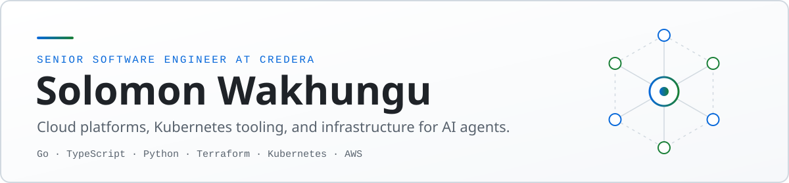

<picture>
  <source media="(prefers-color-scheme: dark)" srcset="assets/banner-dark.svg">
  
</picture>

  
  
  

I'm a Senior Software Engineer at Credera, where I build cloud platforms, Kubernetes operations, and CI/CD automation for enterprise teams. Outside of client work I write open-source tooling in Go, TypeScript, and Python, and I send fixes upstream to the infrastructure projects I depend on.

## Merged upstream

| Project | What I changed |
|---|---|
| [hashicorp/terraform-provider-aws](https://github.com/hashicorp/terraform-provider-aws/pull/48962) | Fixed a perpetual in-place diff on ActiveMQ brokers. The provider left `shared_resources` unset, so Terraform marked it unknown after every refresh. Closed two issues. |
| [helm/helm](https://github.com/helm/helm/pull/32339) | Made the `get-helm-3` and `get-helm-4` installers bypass stale CDN responses. After a release, machines running the installer at the same time were getting different Helm versions. |
| [VictoriaMetrics/VictoriaMetrics](https://github.com/VictoriaMetrics/VictoriaMetrics/pull/11258) | Added an `.Interval` template variable to vmalert so alert annotations and dashboard links can use the group's evaluation interval without hardcoding it. |
| [mvschwarz/openrig](https://github.com/mvschwarz/openrig/pulls?q=is%3Apr+author%3A1solomonwakhungu+is%3Amerged) | Four merged daemon fixes: ordinary retries after transient provider failures, factual startup-exit errors, retained queue-wake diagnostics, and opt-in end-to-end tests. |
| [Aviatrix Terraform modules and lab docs](https://github.com/search?q=author%3A1solomonwakhungu+is%3Apr+is%3Amerged+org%3Aterraform-aviatrix-modules+org%3AAviatrixSystems&type=pullrequests) | Nine merged PRs across `terraform-aviatrix-gcp-edge-demo` and `avxlabs-docs`, including an Edge ZTP ISO fix and CI checks for the course content pipeline. |

## Projects

### Kubernetes and platform

**[kfleet](https://github.com/1solomonwakhungu/kfleet)** &nbsp; 
A control plane for running many Kubernetes clusters from one place. A small agent in each cluster reports state to a single Go hub, which serves the REST API, a live React UI, and a SQLite inventory. A built-in MCP server lets AI clients inspect and diagnose the fleet. It ships as Helm charts and container images. [Site](https://kfleet-landing.vercel.app)

**[go-production-api-starter](https://github.com/1solomonwakhungu/go-production-api-starter)** 
A Go REST API laid out the way I'd run one in production: clean architecture, JWT auth, structured logging with `slog`, graceful shutdown, Postgres, Kubernetes manifests, Terraform, and CI.

**Terraform modules for AWS:** [private LLM stack](https://github.com/1solomonwakhungu/terraform-aws-private-llm) (Ollama and Open WebUI with automatic TLS), [EKS](https://github.com/1solomonwakhungu/terraform-aws-eks), [VPC](https://github.com/1solomonwakhungu/terraform-aws-vpc), and [ECS Fargate](https://github.com/1solomonwakhungu/terraform-aws-ecs-fargate).

### Infrastructure for AI agents

**[action-hub](https://github.com/1solomonwakhungu/action-hub)** &nbsp; 
Every MCP server an agent connects to loads all of its tool schemas into context on every turn. Action Hub puts one search tool in the context and keeps the catalog behind it, so the context cost stays flat however many servers and skills sit behind the hub. [Explainer](https://1solomonwakhungu.github.io/action-hub/)

**[runpod-vllm-deployer](https://github.com/1solomonwakhungu/runpod-vllm-deployer)** 
A Python CLI that deploys OpenAI-compatible vLLM servers to RunPod GPUs. It plans offline, asks for confirmation before creating anything billable, checks readiness, runs a smoke test, and verifies teardown.

**[googlemcp](https://github.com/1solomonwakhungu/googlemcp)** 
A local stdio MCP server for your own Google account: Gmail, Calendar, Drive, Tasks, and more. It is read-only by default. Write tools need an opt-in per product, and destructive tools need a second one.

### Developer tools

**[gronify](https://github.com/1solomonwakhungu/gronify)** &nbsp;  
Flattens JSON into greppable paths and turns them back into JSON. A gron-style CLI on npm, with an installable skill for coding agents. [Site](https://gronify.vercel.app)

**[discord-cli](https://github.com/1solomonwakhungu/discord-cli)** &nbsp;  
A headless Discord CLI for scripts, CI, and agents. It runs one command and exits, with 50+ commands and JSON output by default.

**[typst-dev-container](https://github.com/1solomonwakhungu/typst-dev-container)** &nbsp; 
A Typst and Pandoc dev container for reproducible PDF builds in Docker, VS Code, and Codespaces. The image is published to `ghcr.io` and the toolchain updates itself through CI.

### Homelab

[homeserver-infra](https://github.com/1solomonwakhungu/homeserver-infra) manages my Proxmox servers with Terraform. [homelab-core](https://github.com/1solomonwakhungu/homelab-core) runs the routing, logging, and alerting on top.
